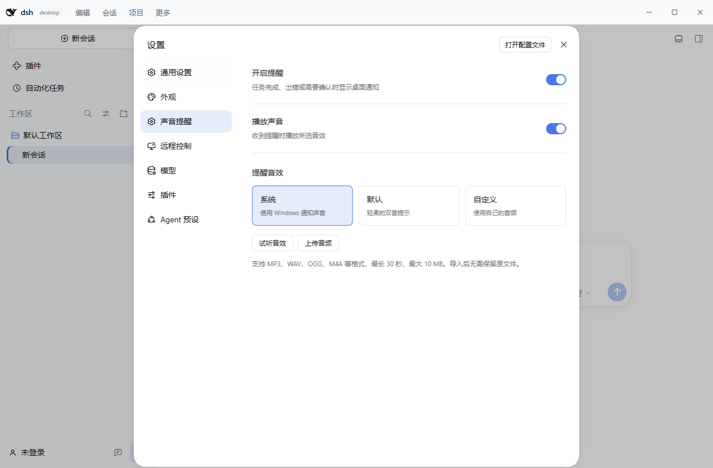
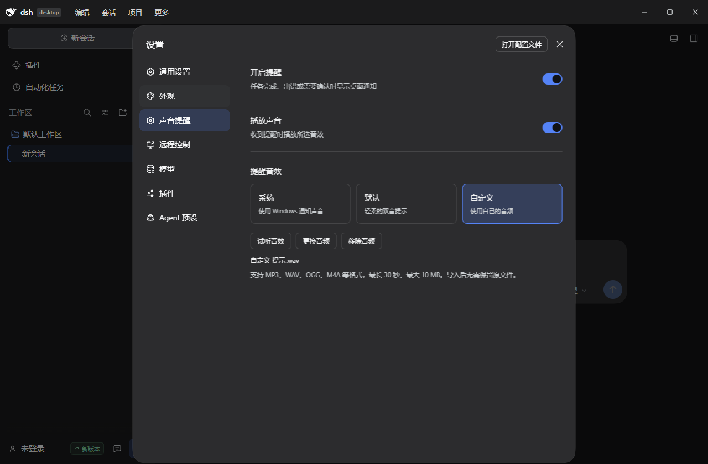

# 声音提醒验证

验证日期：2026-11-06。环境：Windows x64、WebView2、DSH 0.2.1-rc.2。

设置导航中的“声音提醒”紧接“外观”。默认保持提醒和声音开启，并使用系统音效。关闭提醒同时停止通知和声音；仅关闭声音保留桌面通知。自定义音频在导入时转换成单声道 PCM WAV，随桌面设置持久保存，不依赖原文件。

“默认”音效已改为用户提供的 `plop.ogg`，转换为约 0.173 秒的 PCM WAV 并内置到程序，保留原有音量与音调。原始音频和转换结果保存在 `src-tauri/assets/sounds/`。

## 已完成验证

- JavaScript 设置、通知事件、旧版兼容、ACL 和翻译测试通过；设置 schema 经真实 Schemastery 重建验证。
- Rust 通知测试：15 项通过，2 项原有手动实机测试默认忽略。新增静音 toast XML、音频格式与大小校验、设置协议解析测试通过。
- 替换为 `plop` 后，2 项声音测试通过；内置 WAV 通过 Windows `PlaySoundW` 内存播放检查。
- `cargo build --manifest-path src-tauri/Cargo.toml` 成功。测试使用独立应用标识避免影响已运行的用户版本，随后已恢复正常开发构建。
- `node tools/sound-settings-smoke.mjs` 使用隔离 profile 和实际 WebView2 完成以下流程，页面无 JavaScript 错误：
  - 导航顺序、提醒开关、声音开关与原生宿主状态一致。
  - 关闭提醒后原生通知被抑制；静音状态仍提交桌面通知。
  - 系统、默认两种音效均通过原生播放命令试听。
  - 自定义音频上传、播放、停止；损坏文件和超过 30 秒的文件不会覆盖已有音频。
  - 完全退出并重新启动后，自定义音频和选择保持，且仍可试听。
  - 窗口关闭到托盘后，通知正常提交且自定义音频播放未报告失败。
  - 移除自定义音频后恢复系统音效。

音频验证检查原生播放 API 的成功结果，未进行扬声器录音测量。Windows 通知设置和音量仍决定实际显示及听觉输出。

## 界面

